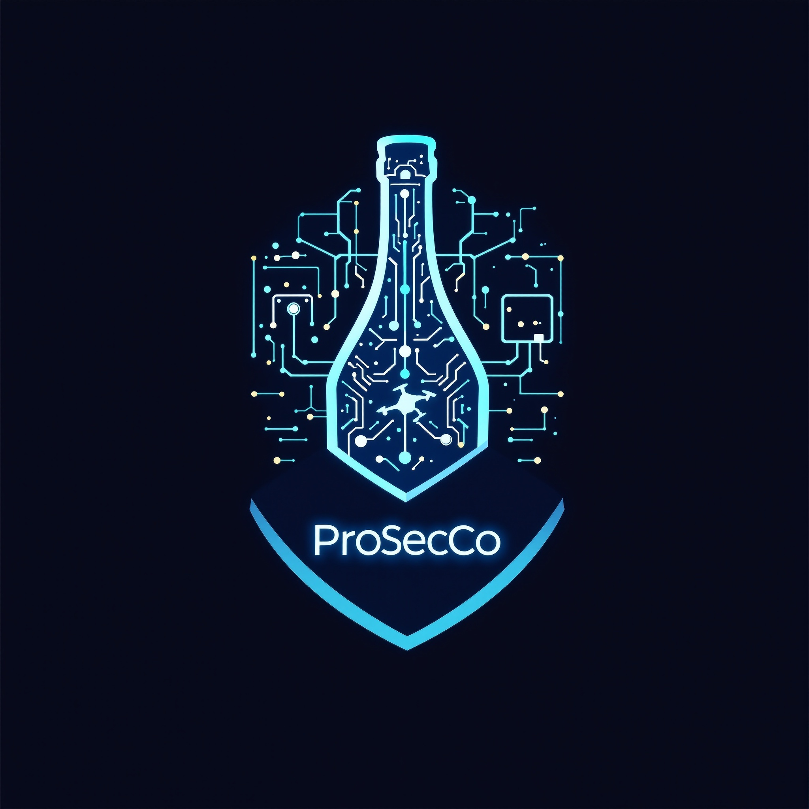

# LABs collection: Ethical Hacking

  

<h1 align="center">Professional Security Corporation</h1>

Laboratories of the Course on
Ethical Hacking (MSc ICT for Internet and Multimedia, A.Y. 2026/27) at University of Padua.

## Members
- Emanuele Artusi | 2198545
- Filippo Bellon | 2199368
- Jacopo Giubilato |
- Alessandro Vulcu |
